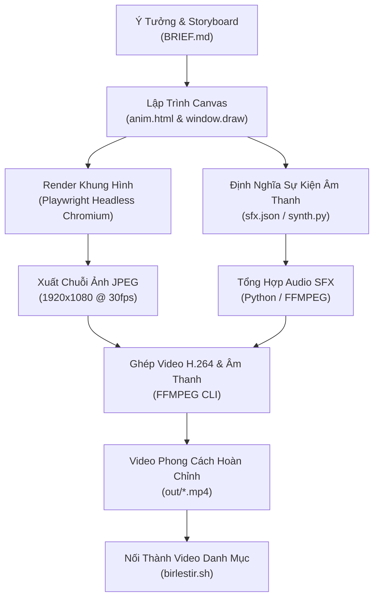

# BÁO CÁO TOÀN DIỆN VỀ 20 PHONG CÁCH HOẠT HỌA (ANIMATION STYLES)
**Dự án:** [Animasyon Stil Kataloğu](file:///d:/animasyon-stil-katalogu)  
**Tác giả gốc:** Yasin Özmeen (`irticalen`)  
**Công nghệ nền tảng:** HTML5 Canvas API (1920×1080), Playwright (Headless Chromium), FFMPEG, Procedural Audio Synthesis  
**Ngày lập báo cáo:** 04/11/2026  

---

## MỤC LỤC
1. [Tổng Quan Dự Án & Kiến Trúc Kỹ Thuật](#1-tổng-quan-dự-án--kiến-trúc-kỹ-thuật)
2. [Bảng Ma Trận Tổng Hợp: Trực Quan Hình Ảnh & Từ Khóa Ứng Dụng](#2-bảng-ma-trận-tổng-hợp-trực-quan-hình-ảnh--từ-khóa-ứng-dụng)
3. [Phân Tích Chi Tiết 20 Phong Cách Hoạt Họa (Hình Ảnh & Từ Khóa Ứng Dụng)](#3-phân-tích-chi-tiết-20-phong-cách-hoạt-họa)
   - [01. Kurzgesagt (Khoa Học Khám Phá & Đồ Họa Phẳng Hiện Đại)](#01-kurzgesagt)
   - [02. İzometrik (Mô Hình Đẳng Cự / Sa Bàn Thu Nhỏ 3D)](#02-izometrik)
   - [03. Bauhaus (Nghệ Thuật Kiến Tạo & Đồ Họa Thụy Sĩ)](#03-bauhaus)
   - [04. Memphis (Thập Niên 80 Hậu Hiện Đại & Rực Rỡ)](#04-memphis)
   - [05. Beyaz Tahta (Bảng Trắng / Whiteboard Explainer)](#05-beyaz-tahta)
   - [06. Kara Tahta (Bảng Phấn Cổ Điển / Lớp Học Truyền Thống)](#06-kara-tahta)
   - [07. Blueprint (Bản Vẽ Kỹ Thuật Lam Bản)](#07-blueprint)
   - [08. Tek Çizgi (Nghệ Thuật Một Nét Liền / Continuous One-Line)](#08-tek-cizgi)
   - [09. Kâğıt Kesik (Cắt Giấy Thủ Công / Paper Cutout Diorama)](#09-kagit-kesik)
   - [10. Karakalem (Phác Thảo Chì Than / Graphite Pencil Sketch)](#10-karakalem)
   - [11. Linocut (Tranh Khắc Bản Mộc / Linoleum Block Print)](#11-linocut)
   - [12. Kil (Đất Nặn Thủ Công / Claymation Stop-Motion)](#12-kil)
   - [13. Retro-70ler (Truyền Hình Thập Niên 1970 & Disco Funk)](#13-retro-70ler)
   - [14. Piksel (Đồ Họa Điểm Ảnh 16-Bit / Retro Video Game)](#14-piksel)
   - [15. Belgesel-16mm (Phim Nhựa Tài Liệu 16mm Cổ Điển)](#15-belgesel-16mm)
   - [16. Çizgi Roman (Truyện Tranh Báo Giấy / Comic Strip & Ben-Day Dots)](#16-cizgi-roman)
   - [17. Terminal (Giao Diện Dòng Lệnh CRT / Hacker Terminal)](#17-terminal)
   - [18. HUD (Giao Diện Kính Lái Tương Lai / Sci-Fi Head-Up Display)](#18-hud)
   - [19. Veri (Trực Quan Hóa Dữ Liệu / Data Journalism & Scrollytelling)](#19-veri)
   - [20. Kinetik Tipografi (Hoạt Họa Chữ Động Nhịp Điệu / Kinetic Typography)](#20-kinetik-tipografi)
4. [Quy Trình Pipeline Sản Xuất Hoạt Họa Bằng Mã Nguồn](#4-quy-trình-pipeline-sản-xuất-hoạt-họa-bằng-mã-nguồn)
5. [Tổng Kết & Đề Xuất Ứng Dụng](#5-tổng-kết--đề-xuất-ứng-dụng)

---

## 1. TỔNG QUAN DỰ ÁN & KIẾN TRÚC KỸ THUẬT

Dự án **Animasyon Stil Kataloğu** là một bộ sưu tập thực nghiệm gồm **20 phong cách hoạt họa khác nhau** được xây dựng nhằm phục vụ nền tảng luyện nói và kênh YouTube *"irticalen"*. Thay vì dựng hoạt họa bằng các phần mềm đồ họa chuyển động truyền thống (như Adobe After Effects, Blender hay Cinema 4D), toàn bộ 20 video này được **sinh tự động 100% bằng code thuần (Canvas API 2D)**.

### Cơ Chế Hoạt Động (Rendering Engine)
1. **Trực quan hóa (`anim.html`)**: Mỗi phong cách được gói gọn trong một file HTML chứa canvas độ phân giải Full HD ($1920 \times 1080$). Một hàm toàn cục `window.draw({t})` nhận tham số thời gian $t$ (tính bằng giây) và trả về dữ liệu hình ảnh dạng Base64 (`image/jpeg` chất lượng cao).
2. **Thu thập khung hình (`render.mjs`)**: Sử dụng trình duyệt không đầu **Headless Chromium** qua thư viện **Playwright** để điều khiển bước thời gian chính xác tại $30\text{ fps}$ (hoặc $12\text{ fps}$ đối với phong cách stop-motion/hand-drawn), xuất ra hàng trăm file ảnh tuần tự.
3. **Tổng hợp âm thanh (`synth.py` / `ses.py` / `sfx.mjs`)**: Các hiệu ứng âm thanh không dùng file ghi âm sẵn mà được tổng hợp bằng thuật toán sóng âm (sine wave, square wave, noise generator, pitch sweep) khớp với từng mốc thời gian sự kiện (`sfx.json`).
4. **Đóng gói video (`ffmpeg` & `birlestir.sh`)**: FFMPEG biên dịch các frame ảnh và kênh âm thanh thành video chuẩn định dạng H.264 (`yuv420p`, CRF 18), sau đó ghép thành một video danh mục tổng thể liền mạch.

---

## 2. BẢNG MA TRẬN TỔNG HỢP: TRỰC QUAN HÌNH ẢNH & TỪ KHÓA ỨNG DỤNG

| STT | Phong Cách | Trực Quan Hình Ảnh Cụ Thể (Mắt Nhìn Thấy Gì) | Các "Key" / Chủ Đề Ứng Dụng Tối Ưu |
|:---:|:---|:---|:---|
| **01** | **Kurzgesagt** | Đồ họa phẳng (Flat Art) nét bo tròn, màu neon bão hòa cao, quầng sáng phát quang, mắt hạt tròn ngây thơ, zoom vô cực vĩ mô sang vi mô. | Khoa học viễn tưởng, thiên văn vũ trụ, vật lý lượng tử, y sinh tế bào, triết học hiện sinh, explainer video. |
| **02** | **İzometrik** | Sa bàn 3D góc nghiêng 30° thu nhỏ như đồ chơi Lego, khối hộp đổ bóng 3 mặt, chi tiết cơ học rơi lắp ghép vào sàn nổi. | Kiến trúc hệ thống, quy trình vận hành công ty, sơ đồ nhà máy, logistics, điện toán đám mây, game quản lý. |
| **03** | **Bauhaus** | Poster chuyển động chuẩn lưới 12 cột Thụy Sĩ, 3 hình cơ bản (tròn, vuông, tam giác), màu gốc (đỏ, vàng, lam), chuyển động thẳng dứt khoát. | Tuyên ngôn thương hiệu, nguyên lý thiết kế, quy tắc lãnh đạo, các bước chiến lược cốt lõi, triết lý kinh doanh. |
| **04** | **Memphis** | Bùng nổ họa tiết chấm bi, dải sọc, lượn sóng ziczac thập niên 80, màu pastel neon, viền đen dày, chuyển động lò xo nảy tưng bừng. | Giới trẻ, Gen Z, lễ hội âm nhạc, thời trang rực rỡ, minigame, đập hộp sản phẩm, video ngắn TikTok/Reels vui nhộn. |
| **05** | **Beyaz Tahta** | Bảng trắng mica có bóng mờ lau cũ, bút dạ đen lướt ngòi vẽ sơ đồ và chữ viết tay theo thời gian thực, camera lia theo ngòi bút. | Khóa học trực tuyến (E-learning), giải thích cơ chế "Làm thế nào", đào tạo nội bộ nhân sự, tóm tắt sách. |
| **06** | **Kara Tahta** | Bảng đá xanh đen nhám, bụi phấn rơi đọng máng gỗ, nét phấn xước vỡ hạt, giẻ lau để lại vệt cánh cung trước khi viết chữ vàng. | Công thức toán học/vật lý, quy tắc ngữ pháp, bài học cuộc sống, định lý bắt buộc nhớ, kiến thức nền tảng. |
| **07** | **Blueprint** | Bản vẽ kỹ thuật giấy lam bản xanh sẫm, lưới milimet, compa và thước đo, mặt cắt giải phẫu ruột gan máy móc với số đo chính xác. | Kỹ thuật cơ khí, kết cấu xây dựng, giải phẫu thiết bị (Teardown), sáng chế phát minh, phần cứng ô tô/máy bay. |
| **08** | **Tek Çizgi** | Một sợi chỉ mực đen duy nhất không bao giờ nhấc ngòi, uốn lượn biến hình mềm mại trên giấy mỹ thuật từ biểu tượng này sang biểu tượng khác. | Nghệ thuật cao cấp, thời trang xa xỉ, thẩm mỹ/spa, thơ ca, thiền định/Yoga, intro/outro thương hiệu sang trọng. |
| **09** | **Kâğıt Kesik** | Tranh hộp đèn 3D cắt giấy nhiều lớp xếp chồng, bóng đổ quang học sâu hút, trăng treo dây cước, lẫy gạt chuyển ngày và đêm. | Truyện cổ tích, thần thoại, ký ức tuổi thơ, môi trường tự nhiên, gia đình và trẻ em, thông điệp xã hội ấm áp. |
| **10** | **Karakalem** | Sổ tay ký họa họa sĩ, các đường gióng tỉ lệ nhạt mờ dần biến thành nét chì than đậm khối và đánh bóng, nét rung rung (Line Boil 12fps). | Quá trình tư duy sáng tạo (Design Process), câu chuyện khởi nghiệp từ sơ khai, hậu trường sản phẩm, phân tích mỹ thuật. |
| **11** | **Linocut** | Tranh in mộc bản 2 màu đen - đỏ cờ trên giấy ngà, vết dao khắc chữ V thô ráp, mực lăn sủi bọt, dập mạnh như con dấu mộc. | Tuyên ngôn hành động, kêu gọi thay đổi, tự do ngôn luận, âm nhạc Punk Rock/Underground, bảo vệ công lý, cổ động. |
| **12** | **Kil** | Khối đất nặn dẻo bóng dưới ánh đèn vàng studio, hằn vết vân tay người nặn, rơi biến dạng bẹp dí nảy tưng, hoạt họa giật 12fps. | Giáo dục mầm non, đồ chơi trẻ em, ẩm thực/nấu nướng gia đình, video hài hước ngộ nghĩnh, DIY thủ công mỹ nghệ. |
| **13** | **Retro-70ler** | Màn hình TV cổ lồi, dải cầu vồng 4 màu uốn lượn, mặt trời sọc ngang, nón kỳ diệu quay số, chữ nhảy theo phách disco, tắt co thành chấm sáng. | Hoài niệm (Nostalgia), âm nhạc Funk/Disco, game show truyền hình cổ, thời trang vintage, intro talkshow cổ điển. |
| **14** | **Piksel** | Game 16-bit SNES sắc cạnh từng điểm vuông, nhân vật chạy nhảy 4 frame, đập khối gạch "?" văng xu, dẫm bẹp quái vật, âm thanh chiptune. | Trò chơi điện tử (Gaming), văn hóa lập trình IT/Geek, gamification, thành tựu cuộc sống (Level Up), vượt ải thử thách. |
| **15** | **Belgesel-16mm**| Thước phim điện ảnh đen trắng rung lắc, vệt xước dọc, hạt nhiễu bạc phim celluloid, đếm ngược đầu cuộn 3-2-1, thẻ chữ phim câm. | Lịch sử nhân loại, nguồn gốc sự vật, tiểu sử danh nhân, phóng sự điều tra tư liệu, bài học kinh nghiệm sâu sắc. |
| **16** | **Çizgi Roman** | Trang báo tranh comic ô chữ nhật, hạt trame in Ben-Day dots, lỗi lệch bản in màu, vệt tốc độ, chữ tượng thanh nổ gai góc "POP!", "BOOM!". | Siêu anh hùng, tình huống hài hước, tranh luận đối thoại kịch tính, phản ứng bất ngờ, marketing dạng truyện tranh. |
| **17** | **Terminal** | Màn hình hacker CRT tối đen phát chữ xanh huỳnh quang, vệt quét scanlines, chữ gõ lách cách, sóng âm ASCII, tắt máy co đường sáng. | An ninh mạng (Cybersecurity), hacker, trí tuệ nhân tạo (Backend AI ngầm xử lý), lập trình hệ thống máy chủ Linux/UNIX. |
| **18** | **HUD** | Kính lái phi thuyền/Iron Man, vector xanh băng siêu mảnh (1px), vòng chia độ xoay ngược chiều, radar quét, khung ngắm khóa mục tiêu. | Phân tích giọng nói/dữ liệu AI, chấm điểm chỉ số hiệu năng (KPIs), xe tự hành, thiết bị thông minh AR/VR tương lai. |
| **19** | **Veri** | Trang báo kinh tế cao cấp The New York Times, đồ thị đường tự vẽ mượt mà, điểm mốc cam nổi bật, cuộn trang scrollytelling cột vươn dài. | Tài chính kinh tế, nghiên cứu thị trường, số liệu chứng minh Trước & Sau, báo cáo thường niên, xu hướng vĩ mô. |
| **20** | **Kinetik Tipografi**| 100% là chữ chuyển động không minh họa, chữ nhỏ cô đơn bung tỏa khổng lồ chiếm trọn màn hình với độ đậm nét tối đa theo nhịp đọc. | Trích dẫn danh ngôn, video ngắn tạo động lực (Motivation), hook 3 giây đầu giữ chân khán giả trên TikTok/Shorts/Reels. |

---

## 3. PHÂN TÍCH CHI TIẾT 20 PHONG CÁCH HOẠT HỌA

### 01. Kurzgesagt
*Khoa Học Khám Phá & Đồ Họa Phẳng Hiện Đại*

- **Hình ảnh trông như thế nào (Trực quan thị giác):**
  - Đồ họa vector phẳng (Flat Art) hiện đại với các nét vẽ hoàn toàn bo tròn, không góc nhọn thô ráp.
  - Sử dụng đường viền tối màu mềm mại (`navy: #27265e`) thay vì viền đen cứng.
  - Màu sắc tươi sáng, bão hòa cao (vàng tươi, xanh ngọc, hồng neon, tím sẫm) trên nền không gian sâu thẳm có các quầng phát sáng mờ ảo (`glow`/`atmo`).
  - Nhân vật và vật thể có đôi mắt hạt tròn ngây thơ, biểu cảm ngộ nghĩnh, chuyển động đàn hồi êm ái như quả bóng cao su.
  - Camera thực hiện cú zoom vô cực đa tầng (Infinite Zoom): Lao thẳng từ vũ trụ bao la xuyên qua tầng khí quyển xuống tận cấu trúc phân tử vi mô.
- **Các "Key" / Chủ đề ứng dụng tối ưu:**
  - *Từ khóa chủ đạo:* **Khoa học viễn tưởng, thiên văn học, vật lý lượng tử, y sinh học (vi khuẩn/virus/hệ miễn dịch), thuyết tiến hóa, biến đổi khí hậu, công nghệ tương lai, triết học hiện sinh.**
  - *Dạng video phù hợp:* Video giải thích kiến thức kỳ thú (Explainer Video), trả lời câu hỏi "Nếu như..." (What If...), bài giảng khoa học STEM dành cho đại chúng.

---

### 02. İzometrik
*Mô Hình Đẳng Cự / Sa Bàn Thu Nhỏ 3D*

- **Hình ảnh trông như thế nào (Trực quan thị giác):**
  - Khung cảnh nhìn từ góc chéo trên cao nghiêng 30 độ (chiếu đẳng cự axonometric không có điểm tụ), tạo cảm giác như một sa bàn đồ chơi thu nhỏ hoặc khối Lego đặt trên lòng bàn tay.
  - Các khối hộp 3 chiều sắc cạnh, phân chia rõ rệt 3 mặt sáng - trung - tối tạo độ nổi khối rõ rệt.
  - Đồ đạc, bàn ghế, thiết bị phòng thu mini được thả từ trên trời rơi xuống và cắm phập vào sàn nhà với độ nảy vật lý nhẹ (`overshoot`), sau đó camera trôi lùi ra xa lộ ra toàn cảnh căn phòng.
- **Các "Key" / Chủ đề ứng dụng tối ưu:**
  - *Từ khóa chủ đạo:* **Kiến trúc hệ thống, quy trình vận hành công ty, chuỗi cung ứng logistics, thiết kế nội thất/văn phòng, quy hoạch đô thị, công nghệ đám mây (Cloud Server), game mô phỏng quản lý.**
  - *Dạng video phù hợp:* Video giới thiệu sản phẩm phần mềm (SaaS workflow), giải thích quy trình kinh doanh, clip giới thiệu môi trường làm việc công ty, video giải thích sơ đồ phân loại nhà máy.

---

### 03. Bauhaus
*Nghệ Thuật Kiến Tạo & Đồ Họa Thụy Sĩ*

- **Hình ảnh trông như thế nào (Trực quan thị giác):**
  - Trông giống hệt một tấm áp phích triển lãm đồ họa Thụy Sĩ cổ điển đang chuyển động.
  - Bố cục được sắp đặt trên hệ thống lưới 12 cột nghiêm ngặt, chỉ sử dụng 3 hình khối hình học cơ bản: Tròn, Vuông, Tam giác trên nền giấy ngà sần có hạt bụi mực cổ điển.
  - Tối giản màu sắc tuyệt đối: Đỏ cờ, Xanh cobalt, Vàng mù tạt và Đen mực.
  - Chuyển động thẳng băng, dứt khoát, xoay góc $45^\circ$ hoặc $90^\circ$ chính xác như cỗ máy đồng hồ cơ khí.
- **Các "Key" / Chủ đề ứng dụng tối ưu:**
  - *Từ khóa chủ đạo:* **Tuyên ngôn thương hiệu (Brand Manifesto), nguyên lý thiết kế, triết lý kinh doanh, các bước chiến lược (Bước 1 - Bước 2 - Bước 3), nghệ thuật & kiến trúc, tư duy phản biện, lãnh đạo.**
  - *Dạng video phù hợp:* Video định vị thương hiệu cao cấp, video mở màn hội nghị thiết kế/công nghệ, clip tóm tắt các nguyên tắc quản trị cốt lõi.

---

### 04. Memphis
*Thập Niên 80 Hậu Hiện Đại & Rực Rỡ*

- **Hình ảnh trông như thế nào (Trực quan thị giác):**
  - Một bữa tiệc thị giác ngập tràn năng lượng của thập niên 1980.
  - Tràn ngập các hoa văn chấm bi (dots), dải sọc chéo, đường lượn sóng ziczac (squiggles) và các dải ruy băng uốn lượn.
  - Tông màu kẹo ngọt pastel neon (hồng phấn, vàng chanh, xanh bạc hà, tím huỳnh quang) được viền đen rất dày tạo sự tương phản cực mạnh.
  - Chuyển động siêu nảy lò xo (`elastic bounce`), các vật thể xoay lắc tinh nghịch và nổ tung thành các mảnh giấy màu confetti.
- **Các "Key" / Chủ đề ứng dụng tối ưu:**
  - *Từ khóa chủ đạo:* **Giới trẻ, phong cách sống Gen Z, lễ hội âm nhạc, thời trang mùa hè, thương mại điện tử, mẹo vặt cuộc sống, minigame, chương trình khuyến mãi/sale lớn.**
  - *Dạng video phù hợp:* Video ngắn TikTok/Instagram Reels/Shorts vui nhộn, clip đập hộp quà tặng, video giới thiệu tính năng ứng dụng di động dành cho người trẻ.

---

### 05. Beyaz Tahta
*Bảng Trắng / Whiteboard Explainer*

- **Hình ảnh trông như thế nào (Trực quan thị giác):**
  - Mặt bảng trắng mica phản chiếu ánh đèn neon nhẹ nhàng, có những vệt bóng mờ lau chưa sạch của bài giảng cũ.
  - Một chiếc bút dạ đen với ngòi nghiêng $45^\circ$ lướt đi thoăn thoắt, mở ra các nét vẽ sơ đồ, hình người que và chữ viết tay đến đâu thì nét mực đen hiện ra đến đó.
  - Camera lia trượt mượt mà theo sát đầu ngòi bút từ khu vực ý tưởng này sang khu vực ý tưởng khác trên mặt bảng rộng.
- **Các "Key" / Chủ đề ứng dụng tối ưu:**
  - *Từ khóa chủ đạo:* **Khóa học trực tuyến (E-learning), đào tạo nhân sự nội bộ, bài giảng giải thích quy trình "Làm thế nào..." (How-to / How it works), phân tích mô hình kinh doanh, tóm tắt sách.**
  - *Dạng video phù hợp:* Bài giảng kỹ năng mềm, video thuyết trình gọi vốn dự án, clip hướng dẫn sử dụng sản phẩm cho khách hàng.

---

### 06. Kara Tahta
*Bảng Phấn Cổ Điển / Lớp Học Truyền Thống*

- **Hình ảnh trông như thế nào (Trực quan thị giác):**
  - Không gian lớp học cổ kính với mặt bảng đá xanh đen thô ráp, phía dưới có máng gỗ đọng đầy bụi phấn li ti.
  - Viên phấn trắng viết đến đâu tạo ra nét vẽ có độ xước hạt ma sát chân thực, phấn vàng dùng để nhấn mạnh ý chính.
  - Một chiếc giẻ lau nỉ xuất hiện lau xóa theo hình vòng cung, để lại vệt bụi phấn ẩm mờ ảo trước khi viết lên câu kết luận trọng tâm.
- **Các "Key" / Chủ đề ứng dụng tối ưu:**
  - *Từ khóa chủ đạo:* **Công thức toán học/vật lý, quy tắc ngữ pháp, bài học cuộc sống, nguyên lý không thay đổi theo thời gian, lời khuyên của tiền bối, những sai lầm kinh điển cần tránh.**
  - *Dạng video phù hợp:* Video ôn luyện thi cử, bài giảng triết lý học đường, video truyền cảm hứng học tập, clip hoài niệm ký ức thời học sinh.

---

### 07. Blueprint
*Bản Vẽ Kỹ Thuật Lam Bản*

- **Hình ảnh trông như thế nào (Trực quan thị giác):**
  - Tờ giấy in kỹ thuật màu xanh dương đậm (Cyanotype) phủ kín lưới ô li milimet sắc nét.
  - Đường nét vẽ màu trắng phát quang vi mô như được gióng từ compa, thước kẻ và bút vẽ kỹ thuật.
  - Thiết bị (ví dụ chiếc micro) được bóc tách từ mặt ngoài đến mặt cắt giải phẫu bên trong, đi kèm các đường gióng kích thước mũi tên, số đo mm, góc đón âm và bảng khung tên kỹ thuật (antet).
- **Các "Key" / Chủ đề ứng dụng tối ưu:**
  - *Từ khóa chủ đạo:* **Kỹ thuật cơ khí chính xác, kiến trúc xây dựng, sáng chế phát minh mới, mổ xẻ phần cứng (Hardware Teardown), công nghệ xe hơi / hàng không vũ trụ, giải mã thuật toán.**
  - *Dạng video phù hợp:* Video khám phá cấu tạo bên trong của đồ công nghệ, clip giới thiệu dự án bất động sản/công trình, video giải thích nguyên lý hoạt động của máy móc.

---

### 08. Tek Çizgi
*Nghệ Thuật Một Nét Liền / Continuous One-Line*

- **Hình ảnh trông như thế nào (Trực quan thị giác):**
  - Một sợi chỉ mực đen duy nhất vô cùng thanh mảnh và tao nhã xuất hiện từ cạnh màn hình trên nền giấy mỹ thuật màu be có sợi xơ thô.
  - Sợi chỉ không bao giờ đứt đoạn, uốn lượn biến hình mềm mại từ biểu tượng bóng thoại sang hình dáng chiếc micro cổ điển, rồi mở rộng thành chữ viết tay nghệ thuật và trôi ra ngoài.
  - Phong cách tối giản tuyệt đối, tôn vinh vẻ đẹp thuần khiết của hình học và đường cong Bézier.
- **Các "Key" / Chủ đề ứng dụng tối ưu:**
  - *Từ khóa chủ đạo:* **Nghệ thuật đương đại, thời trang xa xỉ (Luxury Fashion), thẩm mỹ viện / spa thư giãn, quán cà phê boutique, nội dung thiền định / Yoga, tình yêu lãng mạn, thơ ca.**
  - *Dạng video phù hợp:* Video mở đầu/kết thúc (Intro/Outro) thương hiệu sang trọng, clip quote triết lý nhẹ nhàng, video thiệp mời sự kiện cao cấp.

---

### 09. Kâğıt Kesik
*Cắt Giấy Thủ Công / Paper Cutout Diorama*

- **Hình ảnh trông như thế nào (Trực quan thị giác):**
  - Giống như một chiếc hộp đèn tranh giấy nghệ thuật (Shadow Box) hoặc cuốn sách tranh nổi 3D (Pop-up Book).
  - Từng lớp giấy bìa cứng có thớ xơ được cắt thành hình đồi núi, ngôi nhà, vầng trăng xếp tầng từ trước ra sau, tạo nên chiều sâu không gian quang học với các lớp bóng đổ thực tế.
  - Các chi tiết trồi lên với độ uốn cong cơ học nhẹ, vầng trăng đung đưa trên dây cước, khi chuyển cảnh có chiếc lẫy giấy gạt qua làm đổi chiều nguồn sáng từ đêm sang bình minh.
- **Các "Key" / Chủ đề ứng dụng tối ưu:**
  - *Từ khóa chủ đạo:* **Truyện cổ tích, thần thoại, ký ức tuổi thơ, thiên nhiên và bảo vệ môi trường, tình cảm gia đình, văn hóa dân gian, câu chuyện ngụ ngôn giàu cảm xúc.**
  - *Dạng video phù hợp:* Phim hoạt hình ngắn cho thiếu nhi, video kể chuyện cổ tích, clip chúc mừng năm mới/Giáng sinh, chiến dịch vì cộng đồng.

---

### 10. Karakalem
*Phác Thảo Chì Than / Graphite Pencil Sketch*

- **Hình ảnh trông như thế nào (Trực quan thị giác):**
  - Trang sổ tay ký họa của họa sĩ với thớ giấy nhám hạt.
  - Ban đầu là những đường nét dựng khung mờ ảo (trục đối xứng, hình khối elip), sau đó ngòi chì than 2B đậm đè lên định hình chi tiết và các mảng đánh bóng đan nét (cross-hatching) tạo khối.
  - Toàn bộ nét vẽ có độ rung rinh nhẹ liên tục (*Line Boil 12fps*) tạo cảm giác bản phác thảo đang sống động ngay trước mắt, kết thúc bằng hiệu ứng lật trang sổ.
- **Các "Key" / Chủ đề ứng dụng tối ưu:**
  - *Từ khóa chủ đạo:* **Quá trình tư duy sáng tạo (Design Thinking), nhật ký khởi nghiệp từ ý tưởng sơ khai, hậu trường sản xuất sản phẩm (Behind the scenes), chân dung nhân vật lịch sử, phân tích hội họa.**
  - *Dạng video phù hợp:* Video "Ý tưởng này đã ra đời như thế nào?", clip chia sẻ kinh nghiệm sáng tác của nhà thiết kế, video giải thích lộ trình phát triển dự án.

---

### 11. Linocut
*Tranh Khắc Bản Mộc / Linoleum Block Print*

- **Hình ảnh trông như thế nào (Trực quan thị giác):**
  - Tranh in khắc gỗ/cao su đậm chất cổ động, mạnh mẽ và thô mộc.
  - Giới hạn nghiêm ngặt chỉ dùng 2 màu mực tương phản gắt: Mực đen đặc và Đỏ cờ in chồng trên giấy ngà, lộ rõ vết hằn khung ép mộc bản (`plate mark`).
  - Hình ảnh tạo bởi các đường rãnh khoét chữ V sắc cạnh của dao khắc, các vệt mực lăn không đều để lại đốm li ti.
  - Chuyển động giật dứt khoát 12fps với hiệu ứng mực in nổi bập bùng, kết thúc bằng cú dập con dấu mộc đanh thép.
- **Các "Key" / Chủ đề ứng dụng tối ưu:**
  - *Từ khóa chủ đạo:* **Tuyên ngôn hành động, kêu gọi thay đổi, tinh thần nổi loạn, âm nhạc Rock/Underground, bảo vệ quyền lợi cộng đồng, thông điệp truyền cảm hứng mạnh mẽ, tinh thần chiến binh.**
  - *Dạng video phù hợp:* Video kêu gọi hành động (Call-to-Action), clip cổ động phong trào xã hội, teaser album nhạc cá tính, tuyên ngôn văn hóa doanh nghiệp.

---

### 12. Kil
*Đất Nặn Thủ Công / Claymation Stop-Motion*

- **Hình ảnh trông như thế nào (Trực quan thị giác):**
  - Những khối đất sét nặn dẻo bóng nhiều màu sắc (ngọc lam, vàng mù tạt, đỏ đất) đặt trên mặt bàn gỗ dưới ánh đèn spotlight vàng ấm cúng.
  - Bề mặt đất nặn in hằn những vết lõm dấu vân tay người nặn di chuyển ngẫu nhiên giữa các khung hình.
  - Khối đất sét rơi từ trên cao xuống nảy tưng, bị nén dẹp dí rồi nhào nặn biến hình thành nhân vật và chữ cái. Tốc độ chuyển động giật 12fps kinh điển của nghệ thuật stop-motion.
- **Các "Key" / Chủ đề ứng dụng tối ưu:**
  - *Từ khóa chủ đạo:* **Giáo dục mầm non, đồ chơi trẻ em, ẩm thực và làm bánh tại gia, hoạt hình hài hước giải trí, tình cảm gia đình ấm áp, liệu pháp tâm lý thư giãn, DIY thủ công mỹ nghệ.**
  - *Dạng video phù hợp:* Hoạt hình ngắn cho thiếu nhi, video quảng cáo đồ ăn vặt/bánh kẹo/sữa tươi, clip hướng dẫn làm đồ handmade.

---

### 13. Retro-70ler
*Truyền Hình Thập Niên 1970 & Disco Funk*

- **Hình ảnh trông như thế nào (Trực quan thị giác):**
  - Màn hình ti vi đèn hình cathode lồi cổ điển bật sáng với tông màu ấm áp đặc trưng: Vàng nghệ, cam cháy, nâu đất.
  - Nổi bật với dải cầu vồng 4 màu uốn lượn hình sóng, vầng mặt trời chia thành các sọc ngang song song, vòng quay số phong cách game show *Chiếc nón kỳ diệu*.
  - Chữ nhảy múa rộn ràng theo nhịp điệu nhạc funk disco, chuyển cảnh bằng dải sọc quét ngang và kết thúc bằng hiệu ứng tắt TV co lại thành một chấm sáng nhỏ.
- **Các "Key" / Chủ đề ứng dụng tối ưu:**
  - *Từ khóa chủ đạo:* **Hoài niệm (Nostalgia), âm nhạc Funk/Disco/Soul thập niên 70, văn hóa đại chúng cổ điển, game show truyền hình giải trí, thời trang vintage/retro, văn hóa Hippy.**
  - *Dạng video phù hợp:* Đoạn intro mở đầu cho talkshow giải trí, video tổng hợp kỷ niệm thời xưa, clip quảng bá các bộ sưu tập thời trang mang phong cách cổ điển.

---

### 14. Piksel
*Đồ Họa Điểm Ảnh 16-Bit / Retro Video Game*

- **Hình ảnh trông như thế nào (Trực quan thị giác):**
  - Trò chơi điện tử 16-bit trên hệ máy Super Nintendo (SNES) hoặc Sega Genesis với từng điểm ảnh vuông vức sắc cạnh, không dùng nét mịn.
  - Nhân vật chú micro chạy nhảy 4 khung hình, thu thập đồng tiền xu chữ cái, húc đầu vào khối gạch chấm hỏi "?" văng quà, dẫm bẹp kẻ thù trên đường đi.
  - Chuyển cảnh vỡ hạt khảm điểm ảnh (Mosaic Transition) và màn hình khép vòng tròn đen kinh điển khi hoàn thành màn chơi (Stage Clear).
- **Các "Key" / Chủ đề ứng dụng tối ưu:**
  - *Từ khóa chủ đạo:* **Trò chơi điện tử (Gaming), văn hóa lập trình IT / Hacker, văn hóa Geek/Otaku, thành tựu cuộc sống (Level Up), trò chơi hóa công việc/học tập (Gamification), vượt chướng ngại vật.**
  - *Dạng video phù hợp:* Video chúc mừng cột mốc người đăng ký kênh, clip tổng kết hành trình vượt khó, video giới thiệu game indie, nội dung cho các streamer.

---

### 15. Belgesel-16mm
*Phim Nhựa Tài Liệu 16mm Cổ Điển*

- **Hình ảnh trông như thế nào (Trực quan thị giác):**
  - Thước phim tài liệu đen trắng quay bằng máy phim nhựa 16mm với độ rung lắc cơ học nhẹ và hạt nhiễu bạc phim (film grain) nhảy múa liên tục.
  - Các vệt xước dọc chớp sáng, góc ống kính tối mờ (`vignette`) và ánh sáng chớp giật nhẹ của cửa sổ máy chiếu.
  - Mở đầu bằng vòng tròn đếm ngược số 3-2-1 kèm tiếng bíp âm thanh, máy quay tiến chậm rãi vào chiếc micro kim loại cổ điển giữa chùm sáng rọi qua làn bụi mờ, kết thúc bằng ống kính khép tròn chữ "SON".
- **Các "Key" / Chủ đề ứng dụng tối ưu:**
  - *Từ khóa chủ đạo:* **Lịch sử nhân loại, câu chuyện nguồn cội, tiểu sử các danh nhân thế giới, tư liệu chiến tranh, phóng sự điều tra, những bài học kinh nghiệm sâu sắc của quá khứ.**
  - *Dạng video phù hợp:* Phim tài liệu ngắn mang tính hàn lâm, video mở đầu cho các chuyên đề lịch sử/triết học, video tri ân tưởng niệm.

---

### 16. Çizgi Roman
*Truyện Tranh Báo Giấy / Comic Strip & Ben-Day Dots*

- **Hình ảnh trông như thế nào (Trực quan thị giác):**
  - Trang truyện tranh in màu trên báo giấy chủ nhật với các ô tranh chữ nhật viền đen đậm ngăn cách nhau bởi rãnh trắng.
  - Các mảng màu và bóng đổ được tạo bởi hàng triệu chấm tròn nhỏ li ti (**Ben-Day Dots**), màu in hơi lem lệch trục nhẹ mô phỏng chất lượng in báo giá rẻ.
  - Nhân vật toát mồ hôi run rẩy kịch tính, các vệt đường tốc độ phóng tỏa, bong bóng thoại chữ in hoa hét to kèm từ tượng thanh nổ gai góc: "TIK! TAK!", "POP!", "BOOM!".
- **Các "Key" / Chủ đề ứng dụng tối ưu:**
  - *Từ khóa chủ đạo:* **Siêu anh hùng, tình huống hài hước đời thường, tranh luận đối thoại kịch tính, bất ngờ và bùng nổ, marketing dạng truyện tranh Pop-Art, giải trí châm biếm.**
  - *Dạng video phù hợp:* Video hài kịch ngắn, clip xử lý tình huống giao tiếp thường ngày, video quảng cáo sản phẩm mang phong cách truyện tranh vui nhộn.

---

### 17. Terminal
*Giao Diện Dòng Lệnh CRT / Hacker Terminal*

- **Hình ảnh trông như thế nào (Trực quan thị giác):**
  - Màn hình vi tính CRT tối đen của thập niên 1980 với các dòng chữ và ký tự màu xanh huỳnh quang (Green Phosphor) phát sáng rực rỡ có quầng mờ ảo.
  - Lớp vân sọc quét ngang (scanlines) liên tục chuyển động cùng độ cong lồi của mặt kính bóng đèn hình.
  - Lệnh gõ từng ký tự tự động với con trỏ nhấp nháy, đồng hồ đếm ngược bằng nghệ thuật chữ mã ASCII khổng lồ, thanh sóng âm nhảy múa bằng các ký tự `#`, `=`, `-`. Khi tắt máy, toàn bộ màn hình co lại thành một vệt sáng rồi biến mất.
- **Các "Key" / Chủ đề ứng dụng tối ưu:**
  - *Từ khóa chủ đạo:* **An ninh mạng (Cybersecurity), hacker, trí tuệ nhân tạo (Backend AI ngầm xử lý), quản trị máy chủ Linux/UNIX, lập trình phần mềm, khoa học máy tính, phong cách Ma Trận (Matrix).**
  - *Dạng video phù hợp:* Video giải thích thuật toán hoạt động ngầm bên dưới hệ thống, clip giới thiệu tính năng bảo mật dữ liệu, video công nghệ lập trình chuyên sâu.

---

### 18. HUD
*Giao Diện Kính Lái Tương Lai / Sci-Fi Head-Up Display*

- **Hình ảnh trông như thế nào (Trực quan thị giác):**
  - Màn hình hiển thị trên kính lái thông minh của máy bay tiêm kích tương lai hoặc mắt kính siêu nhân (*Iron Man*).
  - Đồ họa vector đơn sắc lạnh (Xanh băng Ice-Blue) với các đường nét siêu mảnh (chỉ 1 pixel) nổi bật trên nền không gian tối.
  - Các vòng tròn la bàn chia độ xoay ngược chiều nhiều tầng, tia radar quét hình rẻ quạt, các khung ngắm hình học chớp nháy khóa cứng mục tiêu, đồ thị đo sóng tần số và các con số phân tích nhảy biến thiên siêu tốc rồi khóa cứng giá trị.
- **Các "Key" / Chủ đề ứng dụng tối ưu:**
  - *Từ khóa chủ đạo:* **Phân tích giọng nói bằng AI, đo lường chỉ số thông minh (KPIs/Metrics), phương tiện tự hành, công nghệ hàng không vũ trụ, thực tế tăng cường (AR/VR/Smart Glasses), chấm điểm hiệu suất.**
  - *Dạng video phù hợp:* Video báo cáo phân tích hiệu suất thời gian thực, clip chấm điểm bài thi/năng lực, video giới thiệu tính năng xe điện thông minh.

---

### 19. Veri
*Trực Quan Hóa Dữ Liệu / Data Journalism & Scrollytelling*

- **Hình ảnh trông như thế nào (Trực quan thị giác):**
  - Bài báo phân tích số liệu tương tác cao cấp trên các trang tin uy tín như *The New York Times* hoặc *The Economist*.
  - Nền giấy trắng xám thanh lịch, lưới tọa độ mờ tinh xảo. Đường biểu đồ màu xanh navy tự vẽ uốn lượn mềm mại từ trái sang phải, điểm mốc số liệu nổi bật sắc cam (ví dụ sụt giảm $-78\%$).
  - Khi trang web tự cuộn xuống (*scrollytelling*), các thanh biểu đồ cột vươn dài ra và các con số phần trăm nhảy mượt mà không rung giật layout.
- **Các "Key" / Chủ đề ứng dụng tối ưu:**
  - *Từ khóa chủ đạo:* **Tài chính kinh tế, nghiên cứu thị trường, thống kê xã hội học, kết quả kinh doanh năm/quý, so sánh trước và sau khi sử dụng (Before vs After), biến đổi khí hậu, báo cáo đầu tư.**
  - *Dạng video phù hợp:* Báo cáo tài chính cho cổ đông, video phân tích dữ liệu thị trường, clip chứng minh sự tiến bộ vượt bậc của học viên/khách hàng.

---

### 20. Kinetik Tipografi
*Hoạt Họa Chữ Động Nhịp Điệu / Kinetic Typography*

- **Hình ảnh trông như thế nào (Trực quan thị giác):**
  - Hoàn toàn không có hình vẽ hay nhân vật nào. Toàn bộ màn hình là sân khấu của những con chữ chuyển động với sự tương phản kích cỡ cực đại trên nền giấy ấm.
  - Mở đầu bằng những chữ cái nhỏ bé, cô đơn lọt thỏm giữa không gian trống trải thể hiện sự ngập ngừng ("Trước hết bạn im lặng"), sau đó từng từ rơi xuống theo nhịp đọc.
  - Camera zoom phóng đại bất ngờ khi thông điệp bùng nổ chiếm lĩnh toàn bộ khung hình với độ đậm nét chữ tăng từ mảnh lên tối đa (Variable Font Weight) cùng sắc đỏ rực lửa: "BẠN ĐANG NÓI!".
- **Các "Key" / Chủ đề ứng dụng tối ưu:**
  - *Từ khóa chủ đạo:* **Thông điệp truyền cảm hứng (Motivational Quotes), video ngắn dạng Hook 3 giây đầu trên TikTok/Reels/Shorts, video lời bài hát (Lyric Video), trích dẫn danh ngôn, khẩu hiệu bán hàng then chốt.**
  - *Dạng video phù hợp:* Video truyền động lực mỗi sáng, video quảng cáo tập trung vào sức mạnh ngôn từ, lyric video ca nhạc, clip hook mở đầu video YouTube.

---

## 4. QUY TRÌNH PIPELINE SẢN XUẤT HOẠT HỌA BẰNG MÃ NGUỒN

---

## 5. TỔNG KẾT & ĐỀ XUẤT ỨNG DỤNG

Bằng việc hiểu rõ cả **đặc trưng thị giác trực quan (Visual Appearance)** lẫn **các chủ đề ứng dụng tối ưu (Use Case Keys)** của từng phong cách trong danh mục 20 phong cách trên, người sáng tạo nội dung hoặc nhà phát triển có thể:
1. **Lựa chọn chính xác phong cách ngay từ khâu lên kịch bản:** Chọn phong cách bổ trợ hoàn hảo cho cảm xúc của nội dung (ví dụ: cần tính khoa học chọn *Kurzgesagt*, cần số liệu uy tín chọn *Veri*, cần tạo động lực chọn *Kinetik Tipografi*).
2. **Tối ưu hóa chi phí và tự động hóa quy trình:** Tận dụng triệt để nền tảng code-driven animation sẵn có để sản xuất video hàng loạt bằng máy tính mà không cần tốn hàng giờ chỉnh sửa thủ công trên phần mềm đồ họa nặng nề.

---
*Báo cáo được biên soạn và cập nhật chi tiết dựa trên mã nguồn thực tế của dự án.*
