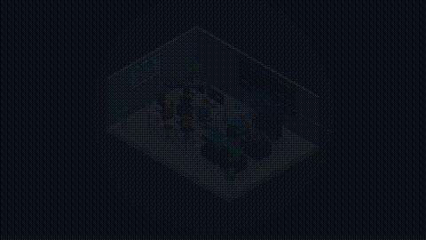
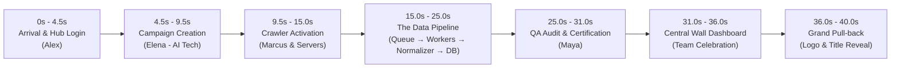

# SOCIAL DATA HUB – THE DATA JOURNEY
**40-Second Continuous Isometric Animated Short Film**



## 1. Executive Summary
- **Title:** SOCIAL DATA HUB – THE DATA JOURNEY
- **Selected Style:** Style 02 – ISOMETRIC (Axonometric 30° projection)
- **Duration:** 40.0 seconds (1,200 frames @ 30 FPS)
- **Resolution:** Full HD 1920×1080 (16:9), H.264 MP4, 48kHz Stereo AAC
- **Core Principle:** ONE continuous isometric camera path, ONE consistent visual style, ONE continuous story connecting four team members and the complete end-to-end data pipeline.

---

## 2. Character Cast & Roles
| Character | Role | Distinct Apparel & Visual Signature | Action in Film |
|---|---|---|---|
| **Alex** | Team Lead / Hub Operator | Navy tailored blazer (`#1e293b`), crisp white collar, cyan tie | Opens Social Data Hub terminal, authenticates system, monitors live throughput |
| **Elena** | Data Analyst | Emerald teal knit sweater (`#0d9488`), tortoiseshell glasses, curly auburn hair | Designs and deploys the AI Technology campaign targeting YouTube & Public Web |
| **Marcus** | Crawler Operator | Cyber coral hoodie (`#ea580c`), dark denim, headphones | Activates the 128-node crawler cluster and server rack arrays |
| **Maya** | QA Engineer | Amber mustard cardigan (`#d97706`), tailored skirt, ponytail, QA tablet | Inspects incoming records, verifies 99.8% data fidelity, certifies & approves batch |

---

## 3. Storyboard Breakdown (40 Seconds Continuous Flow)



1. **[0.0s – 4.5s] Establishing Office & Portal Login:**
   - Cinematic wide view of the modern isometric office in morning light.
   - Continuous camera push-in glides down to Station 1 (Alex).
   - Alex types on keyboard; dual screens boot up with glowing Social Data Hub authentication.
2. **[4.5s – 9.5s] Campaign Creation (Data Analyst):**
   - Camera tracks along the desk to Elena.
   - Holographic interface activates: Target **AI Technology**, sources **[▶ YouTube]** and **[🌐 Public Web]**.
   - Elena clicks "LAUNCH HARVEST"; an energy pulse travels through the fiber line.
3. **[9.5s – 15.0s] Crawler Activation (Crawler Operator & Servers):**
   - Camera follows the signal to Marcus and the three server rack towers.
   - Marcus engages the master switch; 128 crawler spider nodes deploy with cascading cyan/green LEDs.
4. **[15.0s – 25.0s] The Physical Data Journey (Continuous Pipeline Tracking):**
   - **Job Queue (15.0s – 17.5s):** Raw packets enter the FIFO buffer hopper (`BUFFER: 1,420 JOBS`).
   - **Distributed Workers (17.5s – 20.0s):** 4 micro-computing pods unpack payloads, extract transcripts and HTML.
   - **Normalizer Laser Chamber (20.0s – 22.5s):** Laser scanning rings strip raw noise and format clean unified JSON schema.
   - **MySQL Storage Cluster (22.5s – 25.0s):** Clean records slot into spinning tiered database cylinders (`COMMIT`).
5. **[25.0s – 31.0s] QA Audit & Approval (QA Engineer):**
   - Camera pans to Maya's station as she reviews real-time metrics (`ACCURACY: 99.8%`).
   - Maya taps the green validation seal; a golden ring ripples outward confirming batch certification.
6. **[31.0s – 36.0s] Central Screen Streaming & Team Sync:**
   - Live stream fills the giant Wall Screen with real-time sentiment analysis graphs and record counters ($1,250,000+$).
   - All four team members turn to the central screen and celebrate their collective success.
7. **[36.0s – 40.0s] Grand Finale Pull-back & Logo Reveal:**
   - Sweeping camera pull-back reveals the entire thriving isometric architecture, team, and city view.
   - The dimensional title **"SOCIAL DATA HUB – THE DATA JOURNEY"** rises gracefully into the upper space.

---

## 4. Technical Specifications & Files
- `anim.html`: Pure HTML5 Canvas isometric engine (1920×1080) with deterministic `window.draw({t})` API.
- `synth.py`: Procedural 40-second 48kHz stereo synthesizer generating ambient pads, typing clicks, server hum, laser sweeps, and crystalline chords.
- `render_all.py`: Multi-threaded headless Chrome renderer and FFMPEG encoder.
- `social_data_hub.mp4`: The final master video (1920×1080, 30 FPS, H.264, 40.00s, ~21 MB).
- `preview.gif`: Short looping animation preview.
- `preview_grid.jpg`: 16-frame contact sheet showing chronological progression.

---

## 5. How to Re-render
To re-render the complete video from source:
```bash
python render_all.py
```
Outputs `social_data_hub.mp4` in ~20 seconds using 4 parallel headless Chrome workers.
